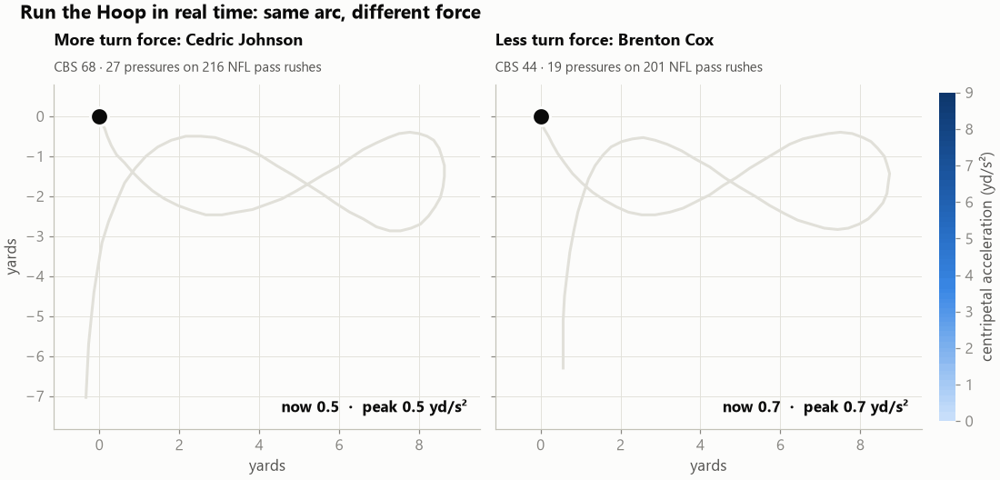

# Bend You Can Measure

**A Combine turn-force score that predicts NFL pass-rush pressure** — my entry to the [NFL Big Data Bowl 2027](https://www.kaggle.com/competitions/nfl-big-data-bowl-2027) on Kaggle.



Scouts grade a pass rusher's **bend** (turning the corner at full speed) by eye; the stopwatch can't see it. Using the 10 Hz sensor tracking from the NFL Scouting Combine, this project turns bend into physics: **centripetal acceleration** (speed × turning rate) in the defensive-line arc drills, summarized as the **Combine Bend Score (CBS)**.

## Key results

| | |
|---|---|
| Effect | +1 SD of CBS ≈ **+1 pressure per 100 pass rushes** (95% CI 0.58–1.39), ~13% of the baseline rate |
| Beyond the usual | Independent of draft slot, weight, alignment and the 10-yard split |
| Honest validation | Nested leave-one-draft-class-out test (drills selected without seeing the test class): **5.7% lower out-of-sample error, permutation p = 0.015** |
| Robustness | Effect between +0.83 and +1.11 across 27 combinations of analysis choices |
| Hidden talent | Late-round/undrafted rushers with CBS ≥ 60 pressured at the average rate for their alignment; other late picks fell 2.1 pressures/100 short |
| What failed (reported) | Pure burst, non-arc drills, offensive linemen, and a receiver "brake-and-burst" score |

📄 **Writeup:** [`writeup/WRITEUP.md`](writeup/WRITEUP.md)
💻 **Reproducible Kaggle notebook:** https://www.kaggle.com/code/stevanramon/bend-you-can-measure

## Reproduce

The competition data is **not included** (CC BY-NC 4.0). Accept the competition rules on Kaggle and set up a [Kaggle API token](https://www.kaggle.com/settings), then:

```bash
pip install -r requirements.txt
python -c "import os; os.environ['KAGGLEHUB_CACHE']='data/cache'; import kagglehub; kagglehub.competition_download('nfl-big-data-bowl-2027')"

python src/validate_dl.py      # robustness + in-game turn force on every DL pass rush
python src/final_metric.py     # Combine Bend Score and effect sizes
python src/sensitivity.py      # 27 combinations of arbitrary choices
python src/nested_test.py      # nested validation with 1,000 permutations (~15 min)
python src/composite_test.py   # includes the receiver idea that failed
python src/figures.py          # all figures
```

Or open the [Kaggle notebook](https://www.kaggle.com/code/stevanramon/bend-you-can-measure), which runs the same code end to end. It is generated from `src/` by `src/build_notebook.py`.

## Repository layout

```
src/
  data.py              loaders (work locally and on Kaggle)
  features.py          per-frame centripetal acceleration and cut features
  validate_dl.py       robustness checks and in-game turn force
  final_metric.py      Combine Bend Score, effect sizes, player table
  nested_test.py       nested leave-one-class-out validation + permutations
  composite_test.py    composite indices (DL turn force, WR brake-and-burst)
  sensitivity.py       sensitivity to shrinkage, sample minimum, UDFA pick
  figures.py           writeup figures and the animated GIF
  build_notebook.py    assembles the Kaggle notebook from the modules
  dl_viability*.py, screen_turns.py, explore_dl_drills.py   early exploration
notebook/              Kaggle notebook + kernel metadata
figures/               all figures
writeup/               competition writeup and images
```

## Method in one paragraph

For every tracking frame, heading comes from the x/y path, turning rate is its frame-to-frame change, and centripetal acceleration is speed × turning rate, smoothed over 0.3 s. Each player's peak value in three arc drills (Run the Hoop, Run and Club, Front Start Wave + Lateral Reaction) is z-scored and averaged into CBS (50 = average, 10 = 1 SD). The outcome is NFL regular-season pressures over expected per 100 pass rushes, where "expected" is the rate for the player's alignment on each snap, shrunk with 100 pseudo-rushes.

## License

Code: MIT. Data: not distributed; see the competition's terms on Kaggle.
